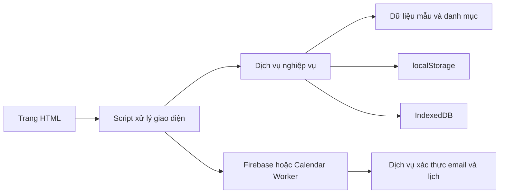

# Thiết kế hệ thống IE104

## Kiến trúc

Website gồm nhiều trang HTML. CSS dùng token và thành phần chung. Script trang đọc DOM, gắn sự kiện và gọi dịch vụ JavaScript. Dịch vụ kiểm tra điều kiện nghiệp vụ rồi đọc, ghi hoặc kết hợp dữ liệu. Dữ liệu mẫu được nạp trước các dịch vụ phụ thuộc. Nhiều script chia sẻ đối tượng `globalThis.IE104` để cung cấp `data`, `storage`, `services` và `ui`.

## Định danh và nơi lưu

| Dữ liệu | Thiết kế |
|---|---|
| Đề tài | Mã nội bộ dùng để tra cứu và liên kết dữ liệu. Mã hoặc tên hiển thị phục vụ người dùng. Khi đồng bộ danh mục, giữ định danh liên kết thay vì dùng tên để ghép bài nộp. |
| Đăng ký và đề xuất | Có mã hồ sơ, người gửi, đề tài/giảng viên liên quan và trạng thái. Dịch vụ phân biệt hồ sơ trực tiếp với hồ sơ cần xử lý. |
| Nhóm và tiến độ | Gắn với mã đề tài. Điều kiện thay đổi dựa trên trạng thái đề tài và quyền trong nhóm demo. |
| Yêu cầu và bài nộp | Cùng mã đề tài và mã yêu cầu. Dữ liệu lần nộp có thời điểm và tham chiếu tệp. Dùng mã và lần nộp để xác định đúng tệp và phản hồi. |
| Bản ghi nghiệp vụ | `localStorage` hỗ trợ lưu qua lần tải lại và thông báo thay đổi qua sự kiện `storage` ở các tab cùng nguồn. `revision` được dùng ở các luồng có kiểm tra thay đổi đồng thời. |
| Tệp | IndexedDB lưu nội dung ảnh hoặc tài liệu theo dịch vụ. Tên tệp chỉ là metadata. Một nút tải cần đối chiếu được nội dung tệp, đối tượng và phiên bản. |
| Phiên và dịch vụ ngoài | Mã phiên website và Firebase có nhiệm vụ riêng. Cấu hình triển khai cần được kiểm tra khi thử Google, OTP và Calendar. |

## Luồng nghiệp vụ

### Tạo đề tài và đăng ký

1. Trình biên tập lấy dữ liệu từ biểu mẫu, kiểm tra trường và tệp rồi gọi dịch vụ lưu đề tài.
2. Dịch vụ công bố biến bản ghi thành dữ liệu đọc phía sinh viên và tính khả năng đăng ký theo trạng thái, thời gian mở và hạn đối với đề tài đã công bố.
3. Sinh viên xác nhận đăng ký. Dịch vụ đọc lại đề tài và kiểm tra dữ liệu nhóm trước khi ghi. Mã phiếu và mã đề tài được dùng để mở lại đúng trang. Đề tài mẫu và đề tài công bố có nguồn dữ liệu riêng.

### Đề xuất và lời mời hướng dẫn

1. Biểu mẫu đề xuất đọc nội dung, giảng viên và đề cương. Dịch vụ tệp hỗ trợ lưu nội dung tệp theo tham chiếu ở các luồng đã nối.
2. Hộp yêu cầu giảng viên đọc các hồ sơ tương ứng. Khi duyệt hoặc từ chối, cập nhật trạng thái và lý do theo luồng. Dịch vụ đề tài đã duyệt chuyển kết quả hợp lệ sang mô hình đề tài thực hiện.
3. Lời mời từ trang riêng có cuộc trao đổi và quyết định. Lời mời từ tab Nhóm gắn với mã đề tài và dùng các hàm `listInvitations`, `invitationDetail` và `respondInvitation` của dịch vụ nhóm để giảng viên tiếp nhận và xử lý.

### Nộp bài và phản hồi

1. Giảng viên tạo yêu cầu gắn với đề tài, nội dung, hạn và trạng thái khóa.
2. Sinh viên chọn tệp. Script tải lên chuyển danh sách tệp cho `saveUpload`. Dịch vụ kiểm tra quyền, yêu cầu, trạng thái khóa và dữ liệu lần nộp. Bản ghi và nội dung tệp nằm trong kho upload IndexedDB. Hai màn hình đọc cùng kho và vẫn có logic tương thích với bản ghi hướng dẫn có từ trước.
3. Phía giảng viên mở bài theo mã. Dịch vụ tệp kiểm tra dữ liệu hiện có trước khi tải. Phản hồi của bài mới được lưu kèm bản ghi upload. Kênh thông báo thay đổi giúp các tab đọc lại và sinh viên thấy bài ở cột Đã phản hồi.
4. Xóa yêu cầu phải đối chiếu bài đã nộp. Khóa yêu cầu ngừng các lần nộp mới và giữ lịch sử. Thử thao tác đồng thời ở hai tab và trường hợp lưu trữ từ chối.

### Đánh giá và lịch

- Đánh giá đọc tiêu chí của đề tài, kiểm tra điểm và tổng trọng số, tính kết quả, rồi lưu hoặc công bố theo phiên bản giao diện. Sinh viên đọc bản đã công bố. Tệp đánh giá được xử lý theo tham chiếu tài liệu.
- Dịch vụ hạn nộp kết hợp mốc đề tài, yêu cầu bài nộp và công việc tiến độ. Trang lịch áp dụng bộ lọc theo đề tài và thời gian. Luồng xuất lịch có cầu nối hoặc Worker tùy cấu hình mã đang chạy.

### Xác thực và thông báo

- Trang đăng nhập kết hợp xử lý tài khoản demo, phiên website và Firebase. Luồng khôi phục tách yêu cầu mã, kiểm tra mã và đổi mật khẩu theo điểm cuối khôi phục. Khi bảo trì chỉ mô tả tên cấu hình, giữ thông tin bí mật ở môi trường triển khai.
- Thông báo lấy danh mục, lọc chuyên mục, phân trang và mở bài theo mã. Trang chi tiết dùng chung cho nhiều bản ghi.

## Kiểm thử và giới hạn

- `node --test tests/*.test.cjs` kiểm thử nghiệp vụ trình duyệt bằng JavaScript. Tại phiên bản khảo sát, 60/69 ca đạt. 9 ca thất bại thuộc nhóm tổng quan giảng viên và mã đề tài.
- `node --test calendar-worker/worker.test.mjs` đạt 3/3 ca. Kiểm thử Firebase Functions cần cài phụ thuộc trong `functions/`. Lượt khảo sát chưa chạy nhóm này.
- Các dịch vụ dùng IndexedDB hoặc localStorage cần thử thêm trên trình duyệt thật với cùng nguồn URL. Với API thật, thử riêng đăng nhập, OTP, cấp quyền Calendar, lỗi mạng và xác nhận kết quả.
- Bản demo một tài khoản sinh viên phù hợp với luồng xác thực nội bộ và thành viên mẫu. Đồng bộ giữa thiết bị và cấp quyền cho từng thành viên cần kiến trúc dữ liệu máy chủ riêng.
